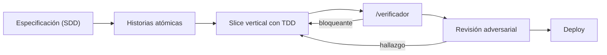

# Flujo agéntico con Claude Code

[](https://github.com/jalonba/flujo-agentico-claude-code/actions/workflows/ci.yml)

**Cómo desarrollo software con agentes de IA:** el método, las skills propias que lo ejecutan y una
app demo construida con ese mismo método, con su historial de commits y sus informes de verificación.

Para quién: equipos técnicos y reclutadores que quieran ver, en código y no en promesas, cómo se
trabaja con agentes sin perder el control de la calidad.

## El flujo



1. **Especificación (SDD, *spec-driven development*):** un PRP (*Product Requirements Proposal*)
   define qué construir y por qué, con criterios de aceptación en formato EARS («CUANDO pasa X, el
   sistema DEBE hacer Y») y ejemplos de entrada → salida. Se aprueba antes de escribir código.
2. **Historias atómicas:** el PRP se parte en historias de usuario (HU) pequeñas; cada criterio
   numerado (`HU-01.c3` = historia 1, criterio 3) se vuelve al menos un test.
3. **Slice vertical con TDD:** una HU por vez, de punta a punta. Test en rojo → código mínimo → verde.
4. **`/verificador`:** nada cuenta como hecho sin **evidencia de ejecución** (salida real de lint,
   tipos, pruebas y build). Además se rompe a propósito cada regla («mutación») para comprobar que
   alguna prueba falla: una prueba que no puede fallar no protege nada (*control positivo*).
5. **Revisión adversarial:** un agente independiente, que no escribió el código, intenta romper lo
   que toca dinero, datos personales o borrado.
6. **Deploy:** con CI en verde y aprobación humana. (La demo de este repo se corre en local; no está
   desplegada.)

Un *gate* es un control que bloquea el avance si no pasa.

Detalle completo: [`docs/flujo.md`](docs/flujo.md).

## El equipo de agentes

Skills de Claude Code en [`.claude/skills/`](.claude/skills/):

| Skill | Qué hace |
|---|---|
| [`orquestador`](.claude/skills/orquestador/SKILL.md) | Punto de entrada: decide qué agente activar, en qué orden, y hace seguimiento |
| [`prp`](.claude/skills/prp/SKILL.md) | Convierte una idea en especificación (PRP) con criterios EARS y backlog de historias de usuario |
| [`bucle-agentico`](.claude/skills/bucle-agentico/SKILL.md) | Implementa una HU con mapeo de contexto *just-in-time* y ciclo TDD; aprende de cada error |
| [`verificador`](.claude/skills/verificador/SKILL.md) | QA con evidencia de ejecución: tests, seguridad, lint, accesibilidad; gate de HU y mutación |

## La demo: agenda de citas

App Next.js 16 + TypeScript + Tailwind + Vitest, **sin backend**: el estado vive en `localStorage`.
Muestra los horarios libres y ocupados de un día y permite reservar uno sin solapes.

Requiere Node.js 22 o superior.

```bash
cd demo && npm ci
npm run dev                                          # http://localhost:3000 (ocupa la terminal)
npm test                                             # en otra terminal, dentro de demo/
npm run lint && npm run typecheck && npm run build
```

**`npm audit`, conocido:** reporta 7 vulnerabilidades moderadas, todas en dependencias de desarrollo
de lint (`minimatch`, vía `typescript-eslint`), fijadas por `eslint-config-next`. No entran en el
build ni en el runtime (`npm audit --omit=dev` da 0) y se resuelven al actualizar ese paquete.

| Historia | Spec | Verificación |
|---|---|---|
| HU-01 · Calcular horarios libres (dominio, TDD estricto) | [HU-01](specs/historias/HU-01.md) | [VER-01](docs/verificaciones/VER-01.md) |
| HU-02 · Ver la agenda del día | [HU-02](specs/historias/HU-02.md) | [VER-02](docs/verificaciones/VER-02.md) |
| HU-03 · Reservar una cita | [HU-03](specs/historias/HU-03.md) | [VER-03](docs/verificaciones/VER-03.md) |

Spec de la feature: [`specs/prp-agenda.md`](specs/prp-agenda.md) · Cerebro del proyecto:
[`CLAUDE.md`](CLAUDE.md).

En el historial se ve el ciclo de cada HU: `test(HU-0X): … (rojo)` → `feat(HU-0X): … (verde)` →
correcciones de lo que encontró el verificador → `docs(HU-0X): VER-0X`. Cada VER documenta los
comandos corridos, las mutaciones probadas (a mano, con el fallo que produjo cada una) y los hallazgos,
incluidos los que obligaron a corregir pruebas que pasaban por la razón equivocada.

## Lecciones

Diez reglas aprendidas operando otras apps en producción con agentes (no esta demo: varias hablan de
migraciones, dinero o tareas programadas), cada una con el error que la originó, en abstracto, y cómo
se verifica hoy: [`docs/lecciones.md`](docs/lecciones.md). Las tres más fuertes:

> **1. Un control sin control positivo no es un control.**
> Si el gate se vería igual con la propiedad rota, no prueba nada.

> **2. Un gate escrito por la misma mano que el código hereda sus puntos ciegos.**
> Por eso hay revisión adversarial con un agente independiente.

> **3. Ninguna prueba lleva fecha literal; una suite que no se ejecuta no tiene color conocido.**
> El reloj se inyecta, y una guardia automática lo hace cumplir.

## Créditos

Las skills [`prp`](.claude/skills/prp/SKILL.md) y [`bucle-agentico`](.claude/skills/bucle-agentico/SKILL.md)
están basadas en la metodología SaaS Factory (V3/V4), adaptadas por Jairo Alonso Baquero.

## Stack y autor

Claude Code · Next.js · React · TypeScript · Tailwind CSS · Vitest · Testing Library · GitHub Actions

**Jairo Alonso Baquero** · [LinkedIn](https://www.linkedin.com/in/jairobaquero-full-stack/) ·
[vextecnology.com](https://vextecnology.com) · Licencia [MIT](LICENSE)

---

### In English

This repository shows how I build software with AI agents: a spec-driven method (PRP with EARS
criteria → atomic user stories → vertical slices with TDD → an execution-evidence verifier →
independent adversarial review → deploy), the Claude Code skills that run it, and a small demo app
(an appointment scheduler in Next.js + TypeScript, no backend) built with that same method. Every
story has red/green commits and a verification report that records the commands run and the manual
mutation checks performed. The docs are in Spanish.
