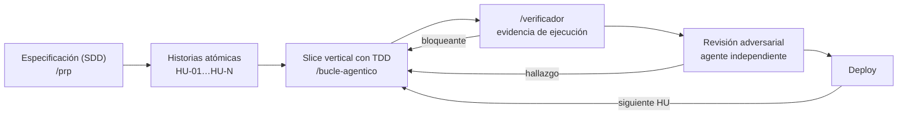

# El flujo: cómo desarrollo software con agentes de IA

El principio que lo ordena todo: **el agente escribe rápido, pero nada cuenta como hecho sin
evidencia de ejecución.** Cada etapa produce un artefacto versionado que la siguiente consume, y
cada transición tiene un gate.

## 1. Especificación (SDD) — `/prp`

Antes de una línea de código, un PRP (Product Requirements Proposal) define **qué** y **por qué**:

- Objetivo en 1–2 oraciones y el problema que resuelve.
- **Criterios de éxito en patrón EARS** (`CUANDO… DEBE…`, `SI… ENTONCES…`, `MIENTRAS…`), cada uno
  verificable con un test.
- Comportamiento esperado, modelo de datos como tabla (sin SQL), ejemplos input → output.
- Checklist de calidad de spec: detalle algorítmico, formato de entrada/salida, ejemplos concretos,
  post-condiciones y cero "debería/podría".

Regla de proporcionalidad: si revisar el PRP toma más que revisar el código, no hace falta PRP.

**Gate humano:** el PRP y su backlog se aprueban antes de implementar.

Ejemplo real: [`specs/prp-agenda.md`](../specs/prp-agenda.md).

## 2. Historias atómicas

El PRP se parte en historias de usuario. Cada una:

- Es un **slice vertical**: atraviesa todas las capas que necesita y deja algo usable.
- Es pequeña (≤ 1 día). Si sale grande, se parte antes de empezar.
- Tiene criterios `HU-XX.cN` numerados: **1 criterio = al menos 1 test**.
- Declara qué queda fuera de alcance, para que el agente no lo invente.
- HU-01 es el "esqueleto que camina": lo mínimo de punta a punta.

Ejemplos: [`specs/historias/`](../specs/historias/).

## 3. Slice vertical con TDD — `/bucle-agentico`

Una HU por vez, con mapeo de contexto **just-in-time** (se planifica la fase al entrar en ella, con
el código real a la vista, no al principio con suposiciones):

1. **Ritual de arranque:** leer el progreso, `git log`, correr los tests. Si algo está rojo, se
   arregla antes de avanzar.
2. **Por cada criterio:** test rojo (que falle *por la razón esperada*) → código mínimo → verde →
   commit.
3. **Auto-blindaje:** cada error encontrado se arregla, se prueba y se documenta como aprendizaje
   (en el PRP, en el skill o en `CLAUDE.md`) para que no se repita.
4. **Paradas obligatorias:** decisión de negocio no especificada, migración destructiva, HU que
   creció más de lo estimado, hallazgo fuera de alcance (se anota, no se implementa).

En el historial de este repo se ve el patrón: `test(HU-01): …` (rojo) seguido de `feat(HU-01): …`
(verde).

## 4. `/verificador` — evidencia de ejecución

El verificador no opina: **corre**. Un veredicto sin la salida de los comandos es "INCOMPLETO".

- `lint`, `typecheck`, `test`, `build` con su salida resumida en el informe.
- Gate de HU: cada criterio con su test; el diff solo toca lo que la HU necesita; piso de calidad
  (validación de entradas, estados de carga/vacío/error, accesibilidad).
- **Control positivo:** todo gate se prueba rompiendo a propósito lo que protege. Un gate que no
  puede fallar no prueba nada.

Informes: [`docs/verificaciones/`](verificaciones/).

## 5. Revisión adversarial

El verificador lo diseñó la misma mano que el código, así que comparte sus puntos ciegos. En toda
fase que toque **dinero, datos personales o borrado** (y antes de publicar cualquier cosa) un
**agente independiente**, sin el contexto del autor, intenta romperlo: busca el caso que el autor
no imaginó.

## 6. Deploy

Solo con CI en verde (lint + typecheck + test + build) y el gate humano: preview + diff. Después,
la siguiente HU vuelve al paso 3.

## Por qué funciona

| Riesgo típico de programar con agentes | Contramedida del flujo |
|---|---|
| El agente "cree" que terminó | Criterios EARS ↔ tests; pass solo con evidencia |
| Cambios enormes imposibles de revisar | Una HU = un slice pequeño = commits pequeños |
| Planes basados en suposiciones | Mapeo de contexto al entrar en cada fase |
| El mismo error dos veces | Auto-blindaje: el aprendizaje queda escrito |
| Gates que siempre dan verde | Control positivo y verificación por mutación |
| Puntos ciegos del autor | Revisión adversarial independiente |

Las reglas aprendidas en producción que sostienen este flujo están en
[`docs/lecciones.md`](lecciones.md).
